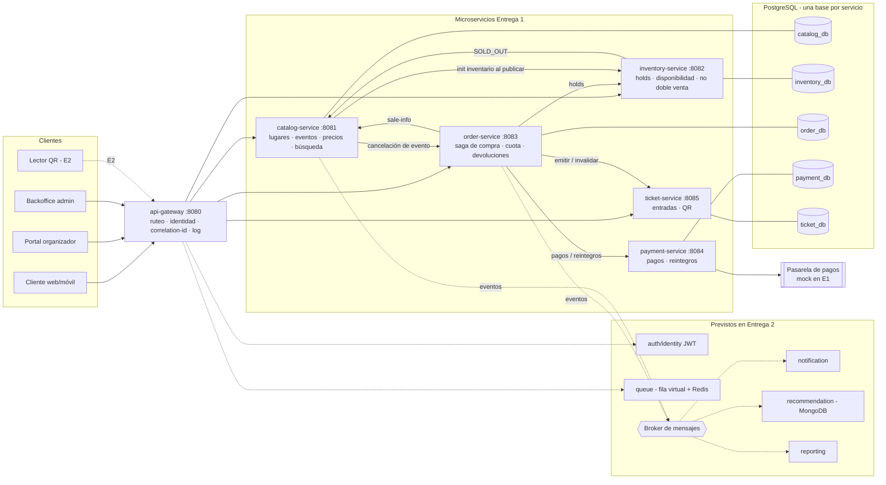
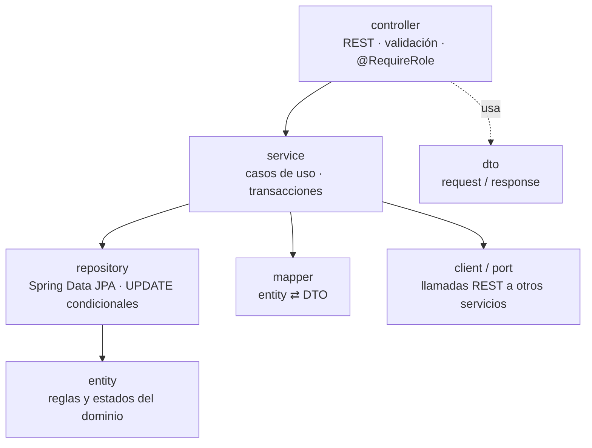

# Arquitectura de microservicios — TicketYa

## 1. Diagrama de módulos (Entrega 1 + extensiones previstas)

Reglas del diagrama: las flechas continuas son REST síncrono; las punteadas son extensiones de E2.
`payment-service` **no** tiene rutas públicas; `/internal/**` nunca pasa por el gateway.

## 2. Responsabilidades y propiedad de datos

| Servicio | Responsabilidad única | Es dueño de | Nunca hace |
|---|---|---|---|
| api-gateway | Entrada única, ruteo, identidad, correlation-id | — | Lógica de negocio, acceso a datos |
| catalog-service | Qué se vende y a qué precio; búsqueda | Venue, Sector, Event, Price | Decidir si un asiento está libre |
| inventory-service | Qué se puede vender ahora (única fuente de verdad) | Seat, ZoneStock, Hold | Conocer precios, clientes o pagos |
| order-service | Orquestar la compra y las devoluciones | Order, Item, Quota, RefundRequest | Mover dinero, emitir QR, decidir disponibilidad |
| payment-service | Mover dinero (o simularlo) | Payment, Refund | Conocer eventos o asientos |
| ticket-service | Emitir y cambiar el estado de entradas | Ticket | Cobrar ni reservar |

## 3. Matriz de comunicación (quién llama a quién)

| Origen \ Destino | catalog | inventory | order | payment | ticket |
|---|---|---|---|---|---|
| **gateway** | ✔ público | ✔ solo `availability` | ✔ público | ✘ | ✔ público |
| **catalog** | — | ✔ init, close | ✔ cancelación | ✘ | ✘ |
| **inventory** | ✔ SOLD_OUT | — | ✘ | ✘ | ✘ |
| **order** | ✔ sale-info | ✔ holds, release | — | ✔ pagos, reintegros | ✔ emitir, invalidar |
| **payment** | ✘ | ✘ | ✘ | — | ✘ |
| **ticket** | ✘ | ✘ | ✘ | ✘ | — |

Dependencias sin ciclos de datos: payment y ticket **no dependen de nadie**; inventory solo notifica estado a catalog.
Las únicas aristas entre servicios de negocio son: order → (catalog, inventory, payment, ticket), catalog → (inventory, order) e inventory → catalog.
Ningún servicio importa clases de otro: cada uno declara sus propios DTO de cable y accede al otro solo por URL (`ticketya.clients.*`).
Cada arista pasa por un puerto (`CatalogPort`, `InventoryPort`, `EventStatusNotifier`, `OrderClient`) que en E2 puede reemplazarse por mensajería.

## 4. Estructura interna de cada servicio (capas)

Patrón único en todos los servicios: `controller → service → repository → entity`, con `dto` y `mapper` en los bordes.
Las llamadas a otros servicios van detrás de una interfaz (`CatalogPort`, `InventoryPort`, `PaymentPort`, `TicketPort`, `EventStatusNotifier`),
lo que permite probar la lógica con dobles y, en E2, cambiar REST por mensajería sin tocar el service.
Patrones usados: **Factory Method** (`OrderException.noEncontrado(...)`, `StockItem.seats(...)`, `HoldItem.zone(...)`),
**Adapter/Port** (clientes REST), **Strategy** (`PaymentGateway`: pasarela simulada hoy, real mañana) y **Saga orquestada** (order).

## 5. Decisiones clave y por qué

| Decisión | Motivo | Evolución |
|---|---|---|
| 5 servicios + gateway | Cada uno es un bounded context con perfil de carga y consistencia propios | + auth, notification, queue, recommendation, reporting |
| Inventory separado de Catalog | Catálogo = lectura cacheable; inventario = escritura caliente no cacheable | Redis para holds en E2 |
| Saga **orquestada** en order | Un único lugar con el estado de la compra; fácil de razonar y testear | Outbox + broker para eventos |
| Anti doble venta en la **base** | Funciona con N instancias; no depende de memoria | Sharding de contadores de zona |
| Snapshots (precio, fecha, etiqueta de asiento) | Desacopla order de catalog después de comprar | — |
| Idempotencia en cada llamada con efectos | Reintentos seguros ante fallas de red | — |
| DTO propio por consumidor | Evita compartir clases de dominio | — |
| Starter técnico sin negocio | Evita repetir filtros/errores/logging sin acoplar dominios | — |
| Sin service discovery en E1 | DNS de Docker alcanza; menos piezas | Eureka/K8s si crece |

## 6. Despliegue E1

Modo Entrega 1: los servicios Spring Boot se ejecutan localmente (`mvn spring-boot:run`, puertos 8080–8085) y solo PostgreSQL
corre en Docker (`docker compose up -d postgres`), con una base y un usuario por servicio (`infra/postgres/init-databases.sql`).
El mismo `compose.yml` ya levanta además cada servicio y el gateway en su contenedor (requisito de la Entrega 2).
