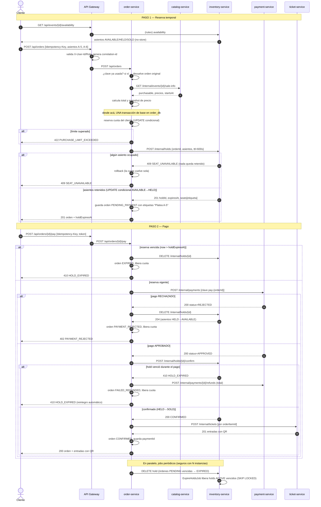
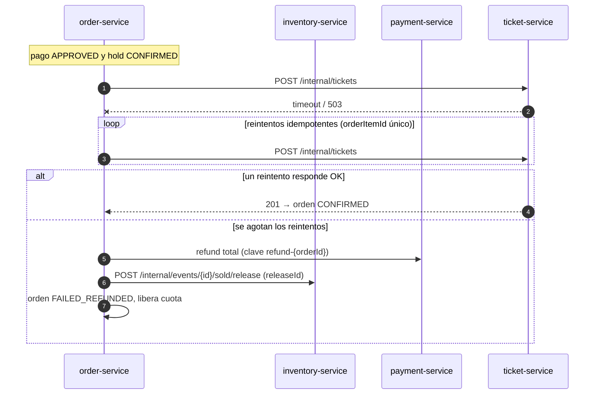
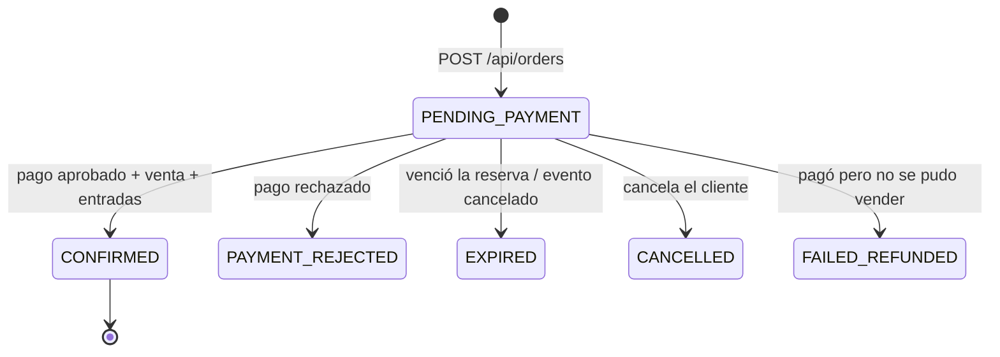
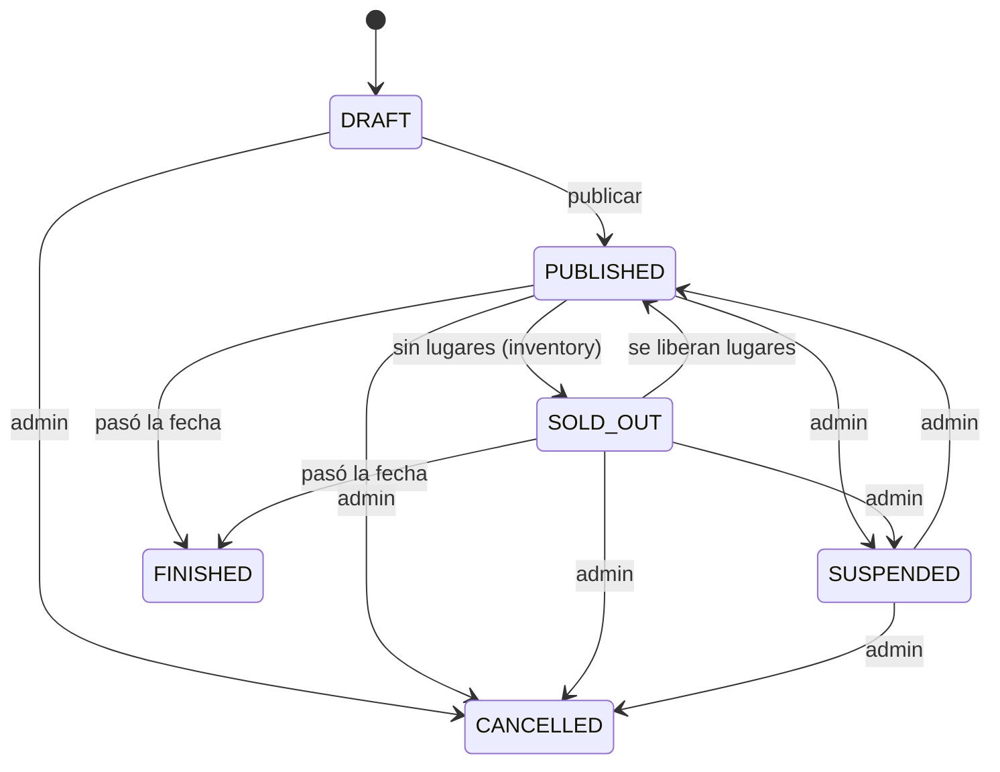
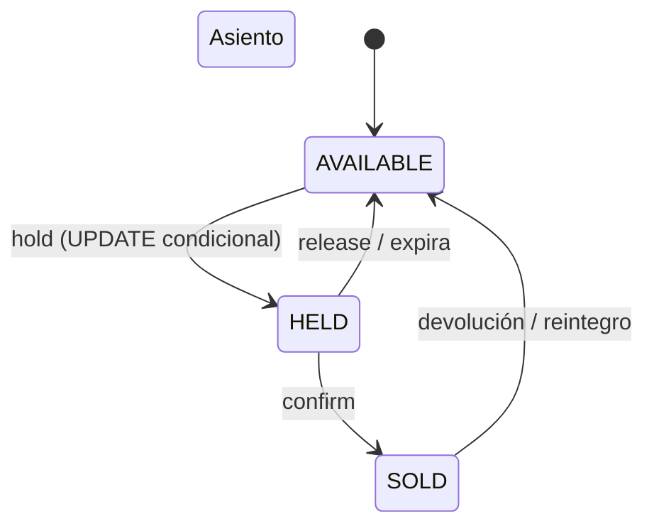

# Diagramas de secuencia — compra de una entrada numerada

Convenciones: `GW` = api-gateway, `O` = order-service, `CA` = catalog, `I` = inventory, `P` = payment, `T` = ticket.
Todos los mensajes llevan `X-Correlation-Id`; las llamadas internas llevan `X-Internal-Token`.
En el código, el paso 1 es `CreateOrderService` y el paso 2 es `PayOrderService` (order-service).

## 1. Flujo completo con rechazo de pago y vencimiento de reserva



## 2. Compensación si falla la emisión de entradas



## 3. Devolución aprobada (saga con roll-forward)

```mermaid
sequenceDiagram
  autonumber
  actor C as Cliente
  actor A as Administrador
  participant O as order-service
  participant T as ticket-service
  participant I as inventory-service
  participant P as payment-service
  C->>O: POST .../refund-requests (≥72 h antes)
  O-->>C: 201 PENDING
  A->>O: POST /api/refund-requests/{id}/approve
  O->>O: PROCESSING (guarda step)
  O->>T: invalidate ticket → REFUNDED
  O->>I: sold/release {releaseId=requestId}
  O->>P: refund {clave refund-{requestId}}
  alt payment falla
    P--xO: 503
    O->>O: queda PROCESSING; RefundRecoveryJob reintenta desde el último paso
  end
  O->>O: ítem REFUNDED, libera cuota, solicitud COMPLETED
```

## 4. Estados






