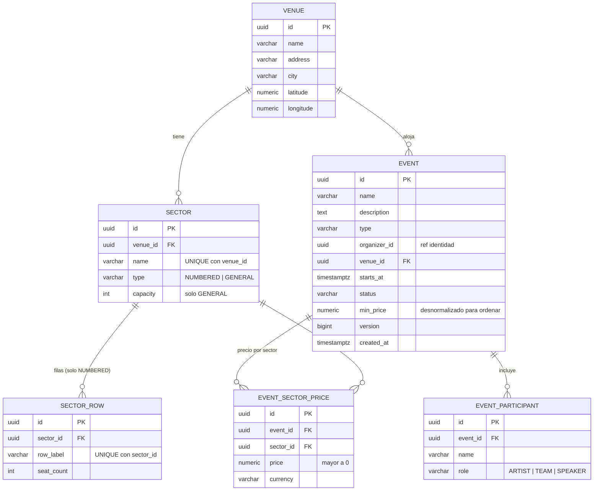
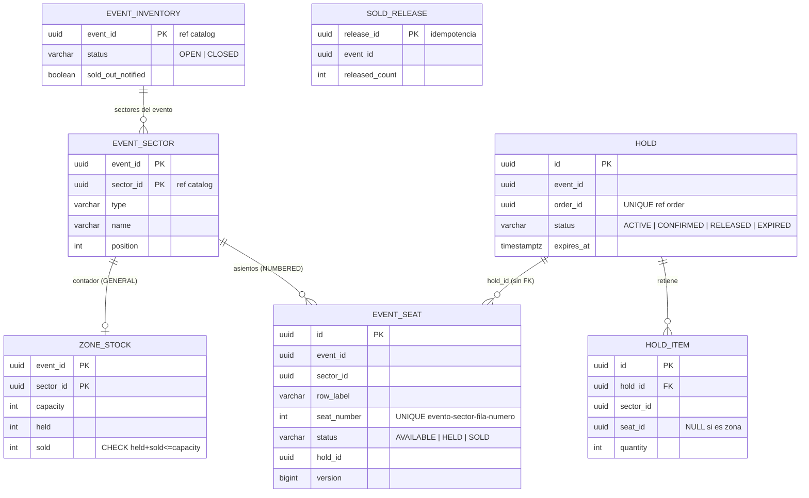
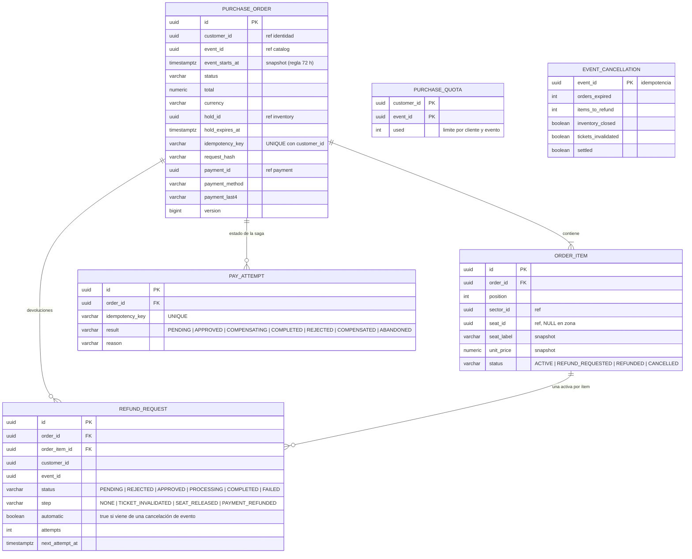
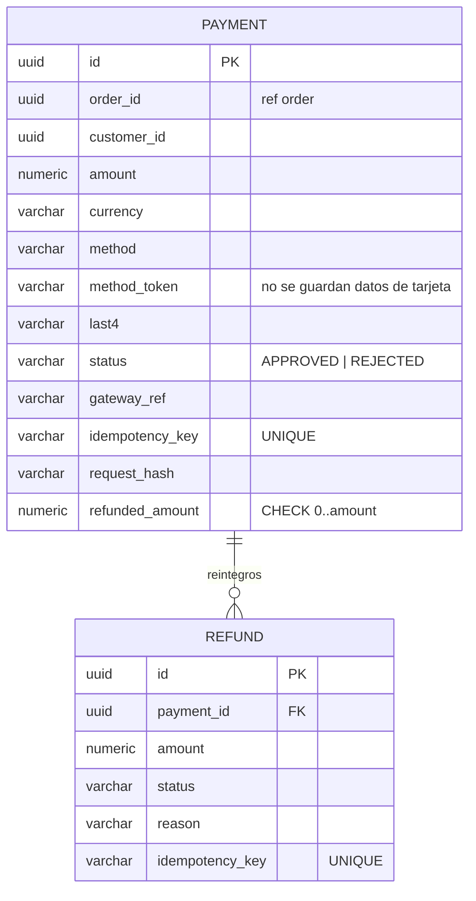
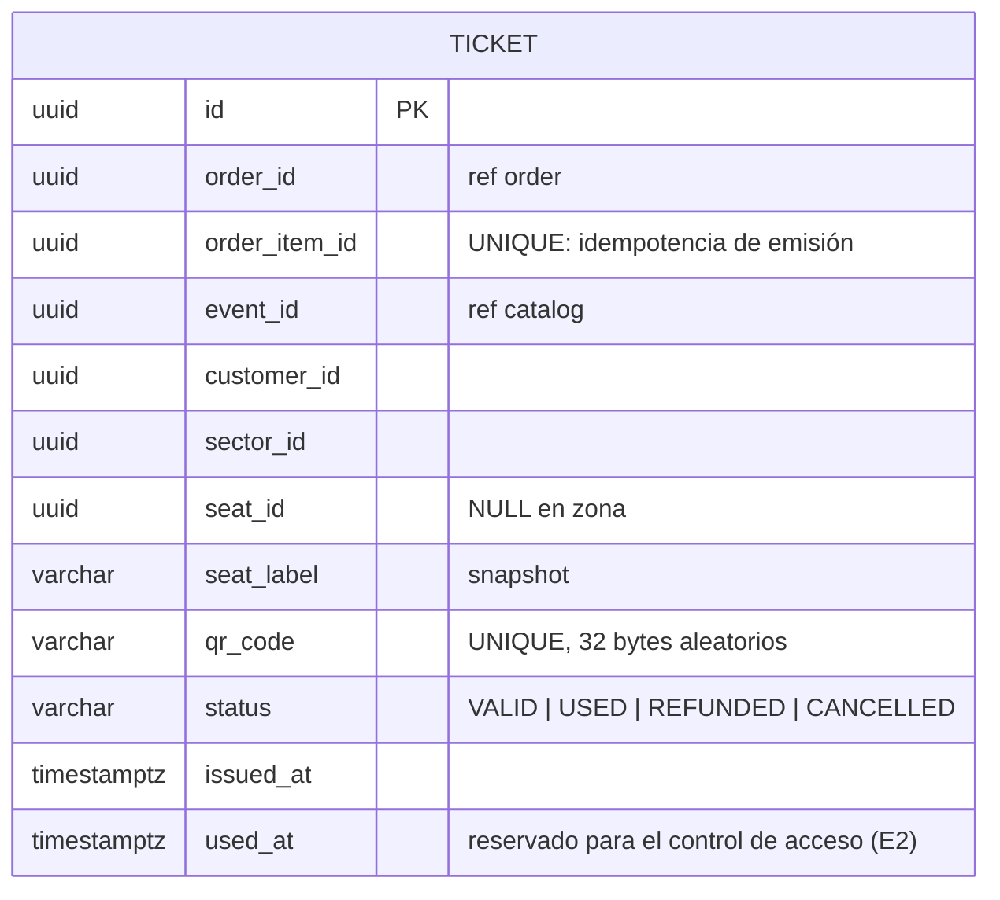

# Modelo de datos — un diagrama entidad-relación por microservicio

Fuente: las migraciones Flyway de cada servicio (`src/main/resources/db/migration/`).
Reglas comunes: PostgreSQL 16, **una base y un usuario por servicio**, `ddl-auto=validate`, IDs `UUID`, dinero `NUMERIC(12,2)`, tiempos `TIMESTAMPTZ`.
**No hay claves foráneas entre bases**: los atributos marcados `ref` son IDs de otro servicio (se validan por API, no por la base).

## 1. catalog_db (catalog-service)

`EVENT_SECTOR_PRICE` tiene `UNIQUE (event_id, sector_id)`: un precio por sector y evento.

## 2. inventory_db (inventory-service)

**Garantía anti doble venta (vive en esta base):** `UPDATE event_seat ... WHERE status='AVAILABLE'` (el que gana ve 1 fila afectada),
`UPDATE zone_stock ... WHERE held + sold + n <= capacity` y el `CHECK ck_zone_stock`, más `UNIQUE (order_id)` en `hold` para reintentos.

## 3. order_db (order-service)

`PURCHASE_QUOTA` se actualiza con `UPDATE ... WHERE used + n <= límite`. `REFUND_REQUEST` tiene un índice único parcial
`(order_item_id) WHERE status IN ('PENDING','APPROVED','PROCESSING')`: una sola solicitud activa por entrada.
Los precios y la etiqueta del asiento son **snapshot**: cambios posteriores en catalog no alteran órdenes ya creadas.

## 4. payment_db (payment-service)

## 5. ticket_db (ticket-service)

## 6. Relaciones entre servicios (sin FK)

| Desde | Atributo | Hacia | Cómo se valida |
|---|---|---|---|
| inventory | `event_inventory.event_id`, `event_sector.sector_id` | catalog `event.id`, `sector.id` | catalog manda el detalle al publicar (`POST /internal/events/{id}/inventory`) |
| order | `purchase_order.event_id`, `order_item.sector_id/seat_id` | catalog / inventory | `sale-info` al crear la orden; inventory rechaza asientos inexistentes al crear el hold |
| order | `purchase_order.hold_id` | inventory `hold.id` | lo devuelve inventory al crear el hold |
| inventory | `hold.order_id` | order `purchase_order.id` | lo envía order (UNIQUE: un hold por orden) |
| order | `purchase_order.payment_id` | payment `payment.id` | lo devuelve payment al cobrar |
| payment | `payment.order_id` | order `purchase_order.id` | lo envía order |
| ticket | `ticket.order_id`, `order_item_id` | order | lo envía order al emitir (UNIQUE por `order_item_id`) |
| catalog / order / payment / ticket | `organizer_id`, `customer_id` | identidad (E2) | en E1 viene del header `X-User-Id` |

## 7. Entidades y datos solapados entre bases

| Dato | Fuente de verdad | Copias | Tipo de copia | Por qué existe | Cómo se mantiene |
|---|---|---|---|---|---|
| Estructura de asientos del lugar | catalog (`sector`, `sector_row`) | inventory (`event_seat`, `zone_stock`) | **Derivada** (una fila por asiento y evento) | inventory necesita una fila por asiento para bloquear | Se crea al publicar (`init` idempotente); desde ahí inventory es dueño del **estado** del asiento |
| Estado SOLD_OUT del evento | catalog (`event.status`) | derivado de inventory (contadores) | **Derivada** | Mostrar "agotado" en búsquedas sin consultar inventory | inventory avisa SOLD_OUT / reapertura a catalog |
| Precio unitario | catalog (`event_sector_price`) | order (`order_item.unit_price`) | **Snapshot** | La compra conserva el precio pactado | Se copia una vez al crear la orden |
| Fecha del evento | catalog (`event.starts_at`) | order (`event_starts_at`) | **Snapshot** | Aplicar la regla de 72 h sin llamar a catalog | Se copia al crear la orden |
| Etiqueta del asiento ("Platea A-5") | inventory (fila/número) + catalog (nombre del sector) | order (`seat_label`), ticket (`seat_label`) | **Desnormalización de lectura** | Mostrar entradas sin joins entre servicios | order la arma con la respuesta del hold y la envía a ticket al emitir |
| Monto de la compra | payment (`payment.amount`) | order (`total`) | **Duplicado intencional** | order calcula el total; payment registra lo cobrado | payment es la autoridad sobre el dinero movido |
| Medio de pago | payment (`method`, `last4`) | order (`payment_method`, `payment_last4`) | **Copia de lectura** | Mostrar el detalle de la compra | Se copia al aprobarse el pago |
| Estado de la entrada vs. del ítem | ticket (`ticket.status`) | order (`order_item.status`) | **Estados relacionados** | Cada servicio modela su ciclo | La saga de devolución actualiza ambos en pasos idempotentes |
| `eventId`, `sectorId`, `seatId`, `orderId`, `orderItemId` | su servicio dueño | inventory, order, payment, ticket | **Referencia / clave de idempotencia** | Correlacionar sin FK | UNIQUE en cada consumidor |

Entre estas copias se aplica **consistencia eventual con compensaciones** (ver `03-sequence-purchase.md`);
dentro de cada servicio, transacciones ACID y restricciones de base.
